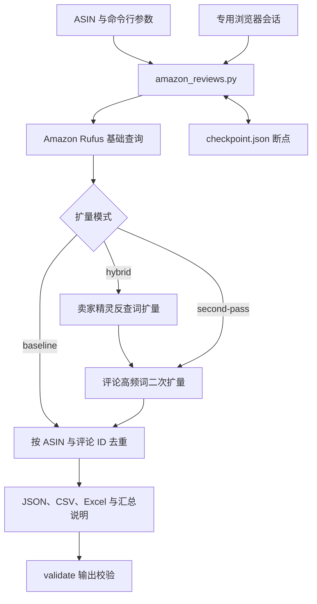

# Amazon 评论样本采集器

## 一眼看懂

- 这是什么：按 ASIN 采集亚马逊竞品的评论样本。
- 什么时候用：要做竞品分析、想先拿一批评论原文时。
- 给它什么：一批 ASIN 和登录好的浏览器会话。
- 它给你什么：评论合并表、数据文件和一份汇总说明。

## 项目简介

`amazon-review-sample-collector` 是可独立运行、也可作为 Codex Skill 使用的 Amazon US 竞品评论样本采集器。默认结合 Amazon 多关键词查询、卖家精灵反查词和评论高频词二次扩量，按 ASIN 与评论 ID 去重后输出 Excel、CSV 和 JSON。

结果是多关键词召回的评论样本，不代表商品的全部评论，也不适合直接推算全量评论的精确占比。

## 核心功能

- 批量处理 ASIN，通过浏览器中的 Rufus `askSearch` 获取评论样本。
- 默认 `hybrid` 模式先执行基础查询，再用卖家精灵反查词和已采集评论中的高频词扩量。
- 卖家精灵不可用时跳过该步骤并继续评论词扩量；支持 `second-pass` 和 `baseline` 两种替代模式。
- 使用专用浏览器资料目录保存登录会话，同一输出目录可在中断后续跑。
- 输出固定八列评论数据，保留各 ASIN 的数量、状态、停止原因及字段非空率。
- 提供环境检查和输出校验，检查 Raw JSON、Excel 字段、评论 ID 与行数一致性。

评论字段依次为：`下载ASIN`、`评论ID`、`评论标题`、`评论内容`、`评论人`、`评论人链接`、`评分`、`评论时间`。

## 技术栈

| 用途 | 技术与约束 |
| --- | --- |
| 命令行与采集流程 | Python 3.10–3.13；`.python-version` 固定为 3.12.13 |
| 浏览器自动化 | Playwright `>=1.55,<2`，托管 Chromium 或本机 Google Chrome |
| Excel 生成与回读 | openpyxl `>=3.1,<4` |
| 文本解析与输出 | Python 标准库 HTMLParser、asyncio、csv、json |
| 打包 | setuptools；项目版本 `0.2.0`，安装包提供 `amazon-review-collector` 命令 |
| 测试 | unittest、GitHub Actions；Windows、macOS、Ubuntu 与 Python 3.10/3.13 矩阵 |

## 快速开始

### 安装与环境检查

```bash
git clone https://github.com/fubo-ops/amazon-review-sample-collector.git
cd amazon-review-sample-collector
python -m venv .venv
```

macOS / Linux 激活环境：

```bash
source .venv/bin/activate
```

Windows PowerShell 激活环境：

```powershell
.venv\Scripts\Activate.ps1
```

安装运行依赖并检查环境：

```bash
python -m pip install -r requirements.txt
python -m playwright install chromium
python scripts/amazon_reviews.py doctor
```

`doctor` 检查 Python 版本及 Python 依赖是否存在，不能替代实际浏览器启动和登录验证。以下命令直接运行脚本，不需要安装命令行入口。

### 首次登录

```bash
python scripts/amazon_reviews.py init-profile
```

程序打开 Amazon 和卖家精灵两个标签页。完成登录后回到终端按 Enter，专用会话默认保存在用户目录下的 `.amazon-review-collector/amazon-profile/`。使用本机 Chrome 时添加 `--browser chrome`；不要并发启动多个使用同一资料目录的采集进程。

### 批量采集与校验

将 `ASIN_A`、`ASIN_B` 替换为真实的 10 位 ASIN：

```bash
python scripts/amazon_reviews.py rufus --asins ASIN_A ASIN_B --output outputs/run-001
python scripts/amazon_reviews.py validate --output outputs/run-001
```

需要查看浏览器过程时添加 `--headed`。中断后使用相同输出目录续跑，明确需要重新开始时才添加 `--restart`。默认模式为 `hybrid`，其他模式示例：

```bash
# 跳过卖家精灵，仅用评论高频词二次扩量
python scripts/amazon_reviews.py rufus --expansion second-pass --asins ASIN_A --output outputs/run-002

# 仅执行基础查询
python scripts/amazon_reviews.py rufus --expansion baseline --asins ASIN_A --output outputs/run-003
```

正常输出包括每个 ASIN 的 `{ASIN}_raw.json`，以及 `评论合并.csv`、`评论合并.xlsx`、`汇总.json`、`采集日志.log`、`采集说明.md`。被中断或受限时保留 `checkpoint.json`，所有 ASIN 完成后删除断点。

结果文件只保留约定字段与汇总信息，不导出浏览器凭据。评论数据、店铺资料、登录会话、断点与生成文件均不提交到 Git；建议统一放在已忽略的 `outputs/` 目录。

## 项目结构

以下完整结构对应 `git ls-files`；运行输出和浏览器资料未列入：

```text
amazon-review-sample-collector/
├── .github/
│   └── workflows/
│       └── test.yml
├── .gitignore
├── .python-version
├── README.md
├── SKILL.md
├── agents/
│   └── openai.yaml
├── pyproject.toml
├── references/
│   ├── output-schema.md
│   └── troubleshooting.md
├── requirements.txt
├── scripts/
│   ├── __init__.py
│   └── amazon_reviews.py
└── tests/
    └── test_amazon_reviews.py
```

`SKILL.md`、`agents/` 和 `references/` 保留 Skill 所需的路径；当前没有需要迁入 `docs/` 的根目录过程文档，也没有已跟踪的运行产物。

## 架构图



卖家精灵不可用时，`hybrid` 流程仍进入评论高频词扩量。采集期间检测到访问限制会记录停止原因并保留恢复状态。

## 当前状态与开发计划

已有混合扩量、持久会话、批量并发、断点恢复、脱敏输出和校验实现。现有离线测试覆盖 HTML 解析、字段契约、去重、模式选择、扩量降级、断点恢复、参数边界及输出校验；CI 配置了三个操作系统与两个 Python 版本。

已准备依赖的环境可执行离线测试：

```bash
python -B -m unittest discover -s tests -v
```

在线效果取决于 Amazon 返回的结果窗口、页面结构、访问状态和卖家精灵登录情况。`validate` 校验文件结构与数量，不能证明采集覆盖全部评论。仓库没有独立的发布路线图；后续开发计划和真实业务环境验收记录待补充。

## 文档

- [Skill 入口与执行流程](SKILL.md)
- [输出字段与数据边界](references/output-schema.md)
- [依赖、登录、会话和访问故障处理](references/troubleshooting.md)
- [离线测试](tests/test_amazon_reviews.py)
- [CI 配置](.github/workflows/test.yml)

## 许可证

待补充。仓库当前未提供 `LICENSE` 文件，使用和分发授权范围需由维护者确认。
